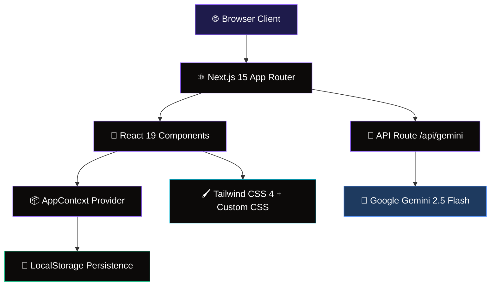
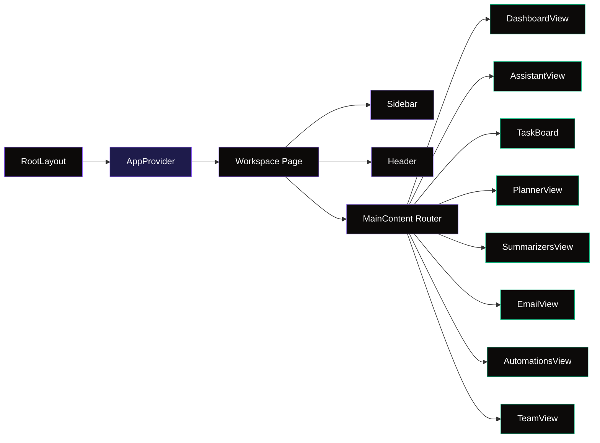
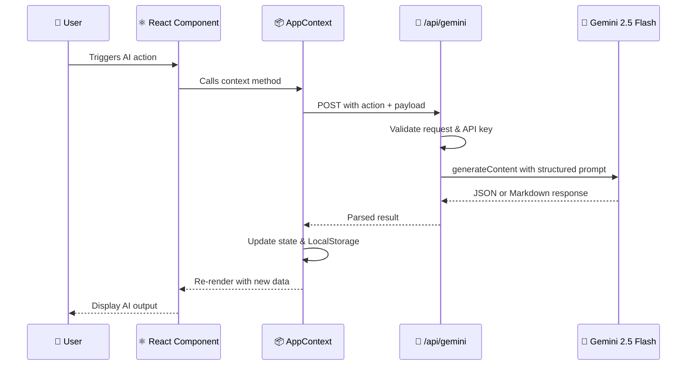
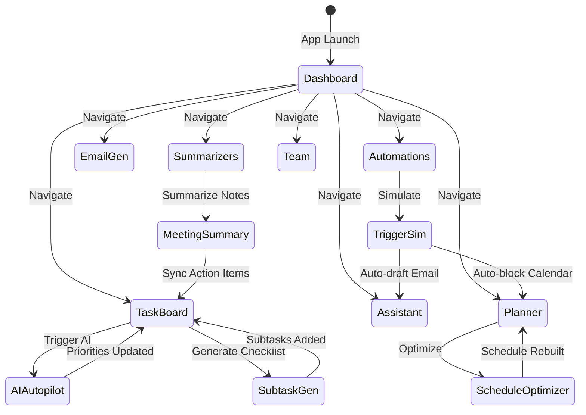
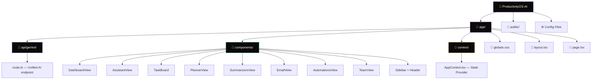
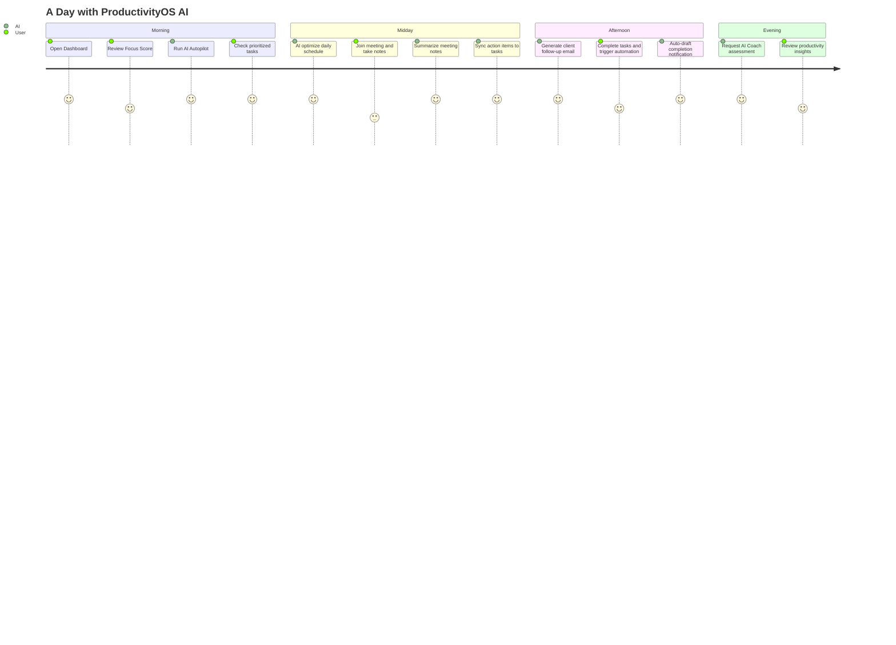
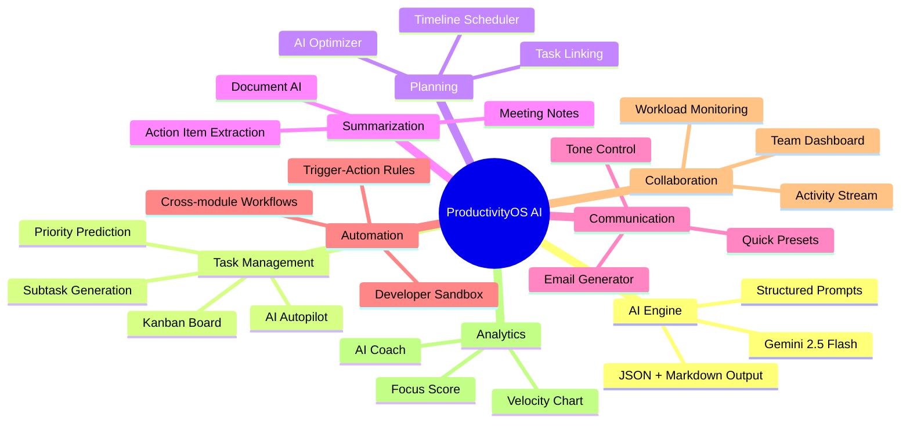

<div align="center">

<!-- Hero SVG Banner -->

# 🧠 ProductivityOS AI

### An AI-powered productivity workspace that helps individuals and teams plan, automate, summarize, collaborate, and accomplish more — using Generative AI.

<br />

[](https://nextjs.org/)
[](https://www.typescriptlang.org/)
[](https://tailwindcss.com/)
[](https://ai.google.dev/)
[](https://react.dev/)
[](LICENSE)

<br />

🌐 **Live App:** https://productivity-os-ai-l66g.vercel.app/

<br />

[🚀 Live Website](https://productivity-os-ai-l66g.vercel.app/) · [📖 Architecture](#-architecture) · [⚡ Quick Start](#-quick-start)

<br />

---

</div>

<br />

## 📋 Table of Contents

- [Features](#-features)
- [Architecture](#-architecture)
- [AI Workflow](#-ai-workflow)
- [Tech Stack](#-tech-stack)
- [Core Modules](#-core-modules)
- [Folder Structure](#-folder-structure)
- [Quick Start](#-quick-start)
- [Environment Variables](#-environment-variables)
- [Development](#-development)
- [Security](#-security)
- [Accessibility](#-accessibility)
- [Performance](#-performance)
- [Roadmap](#-roadmap)
- [License](#-license)

<br />

> **Dashboard** — AI Insights, Focus Time Velocity chart, real-time activity log, and AI Productivity Coach  
> **Task Board** — 4-column Kanban with AI Autopilot, AI Subtask generation, and priority badges  
> **AI Assistant** — Context-aware conversational agent with workspace state awareness  
> **Daily Planner** — Visual schedule board (09:00–18:00) with AI Schedule Optimizer  
> **Meeting Summarizer** — Paste notes → AI executive summary → Sync action items to Task Board  
> **Email Generator** — Configurable tone, length, and recipient with one-click copy  
> **Workflow Automation** — Trigger-action rules with developer sandbox simulator  
> **Team Workspace** — Collaborator cards with workload indicators and collaboration stream  

</details>

<br />

---

## ✨ Features

<table>
  <tr>
    <td align="center" width="25%">
      <br />
      <strong>🎯 AI Task Manager</strong><br />
      <sub>4-column Kanban board with AI Autopilot for auto-prioritization, AI-generated subtask checklists, priority badges, progress tracking, and estimated time</sub>
    </td>
    <td align="center" width="25%">
      <br />
      <strong>🤖 AI Personal Assistant</strong><br />
      <sub>Context-aware conversational agent with full workspace state — tasks, planner events, chat history — for intelligent planning guidance</sub>
    </td>
    <td align="center" width="25%">
      <br />
      <strong>📅 Smart Daily Planner</strong><br />
      <sub>Visual timeline schedule board (09:00–18:00) with AI Schedule Optimizer that balances workload, inserts breaks, and links tasks</sub>
    </td>
    <td align="center" width="25%">
      <br />
      <strong>📝 Meeting Summarizer</strong><br />
      <sub>Paste raw meeting notes → AI generates executive summary with key decisions and action items → one-click sync to Task Board</sub>
    </td>
  </tr>
  <tr>
    <td align="center" width="25%">
      <br />
      <strong>📄 Document Summarizer</strong><br />
      <sub>Condense long documents into summaries, hierarchical outlines, or Q&A flashcards with selectable output format</sub>
    </td>
    <td align="center" width="25%">
      <br />
      <strong>✉️ Email Generator</strong><br />
      <sub>AI-drafted professional emails with configurable tone (5 options), length (3 levels), recipient, and quick-use presets</sub>
    </td>
    <td align="center" width="25%">
      <br />
      <strong>⚡ Workflow Automation</strong><br />
      <sub>If/Then automation rules with triggers (task created/completed) and actions (draft email, add to planner, escalate priority)</sub>
    </td>
    <td align="center" width="25%">
      <br />
      <strong>👥 Team Workspace</strong><br />
      <sub>Collaborator status dashboard with role assignments, workload indicators, and real-time collaboration activity stream</sub>
    </td>
  </tr>
  <tr>
    <td align="center" width="25%">
      <br />
      <strong>📊 Insights Dashboard</strong><br />
      <sub>Workspace Focus Score, Total Focus Time, Task Completion Rate, AI Operations count, SVG velocity chart, and AI Coach</sub>
    </td>
    <td align="center" width="25%">
      <br />
      <strong>🎨 Premium Dark UI</strong><br />
      <sub>Glassmorphism cards, gradient borders, dot-matrix backgrounds, shimmer loaders, and smooth slide-up animations</sub>
    </td>
    <td align="center" width="25%">
      <br />
      <strong>💾 Persistent State</strong><br />
      <sub>All tasks, planner events, automations, chat history, and activity logs are persisted via LocalStorage across sessions</sub>
    </td>
    <td align="center" width="25%">
      <br />
      <strong>🔄 Real-Time Activity</strong><br />
      <sub>Workspace-wide activity log tracking user actions, AI operations, and automation triggers with timestamps</sub>
    </td>
  </tr>
</table>

<br />

---

## 🏗 Architecture

### High-Level Architecture



### Component Architecture



<br />

---

## 🤖 AI Workflow

### AI Request Flow



### Application State Flow



### AI Capabilities

| AI Action | Input | Output | Model Config |
|:----------|:------|:-------|:-------------|
| **Chat Assistant** | User query + workspace context | Context-aware markdown response | `text` output |
| **Task Autopilot** | All tasks (id, title, description) | Priority, estimated time, AI tags per task | `application/json` |
| **Subtask Breakdown** | Task title + description | 3–6 actionable subtask strings | `application/json` |
| **Schedule Optimizer** | Uncompleted tasks + current events | Optimized daily timeline (09:00–18:00) | `application/json` |
| **Meeting Summarizer** | Raw meeting notes text | Executive summary + decisions + action items | `text` (markdown) |
| **Email Generator** | Prompt, recipient, tone, length | Complete email draft (subject + body) | `text` output |
| **Document Summarizer** | Raw document text + format type | Summary, outline, or flashcards | `text` (markdown) |
| **Productivity Coach** | Completed/total tasks, focus hours, logs | Strengths, bottlenecks, 3 action tips | `text` (markdown) |

<br />

---

## 🛠 Tech Stack

| Layer | Technology | Version | Purpose |
|:------|:-----------|:--------|:--------|
| **Framework** | Next.js | 15 | App Router, API Routes, Server Components |
| **Language** | TypeScript | 5 | Strict type safety across the codebase |
| **UI Library** | React | 19 | Component architecture and state management |
| **Styling** | Tailwind CSS | 4 | Utility-first styling with custom design system |
| **AI Engine** | Google Gemini | 2.5 Flash | Generative AI for all intelligent features |
| **AI SDK** | @google/genai | 2.11+ | Official Google Gen AI JavaScript SDK |
| **Icons** | Lucide React | 1.25+ | Consistent, tree-shakeable SVG icon library |
| **Animation** | Framer Motion | 12 | Smooth page transitions and micro-animations |
| **Notifications** | React Hot Toast | 2.6 | Non-blocking toast notification system |
| **Skeletons** | React Loading Skeleton | 3.5 | Shimmer loading states for async operations |
| **Validation** | Zod | 4.4 | Runtime schema validation for data integrity |
| **State** | React Context API | — | Centralized application state management |
| **Persistence** | LocalStorage | — | Client-side data persistence across sessions |

<br />

---

## 📦 Core Modules

| Module | Component | Description |
|:-------|:----------|:------------|
| **Dashboard** | `DashboardView` | 4 metric cards (Focus Score, Focus Time, Completion Rate, AI Ops), SVG velocity chart, real-time activity log, AI Productivity Coach with on-demand analysis |
| **AI Assistant** | `AssistantView` | Chat interface with workspace context injection, suggested commands, loading dots animation, message history, and clear conversation |
| **Task Manager** | `TaskBoard` | 4-column Kanban (To Do → In Progress → Review → Done), task creation modal, task detail modal with status switcher, AI Autopilot, AI Subtask generation |
| **Daily Planner** | `PlannerView` | Agenda sidebar + visual schedule board (09:00–18:00 grid), event creation with task linking, AI Schedule Optimizer |
| **Meeting Notes** | `SummarizersView` (tab 1) | Raw notes input with sample preload, AI executive summary, action item extraction, one-click sync to Task Board |
| **Document AI** | `SummarizersView` (tab 2) | Document input with sample preload, 3 output formats (summary/outline/flashcards), clipboard copy |
| **Email Generator** | `EmailView` | 3 quick presets, configurable tone (5 options) and length (3 levels), recipient field, AI draft with clipboard copy |
| **Automations** | `AutomationsView` | If/Then rule builder, activation toggle, delete, developer sandbox with trigger simulation |
| **Team** | `TeamView` | Member cards with status indicators (online/meeting/offline), workload labels, add member form, collaboration activity stream |
| **Sidebar** | `Sidebar` | Navigation menu with active state indicators, brand header, profile footer |
| **Header** | `Header` | Dynamic view title, task completion badge, automation count, Gemini status indicator |
| **Context** | `AppContext` | Centralized state provider for tasks, planner, automations, chat, team, and activity logs with full CRUD + AI integrations |

<br />

---

## 📁 Folder Structure

```
ProductivityOS-AI/
├── app/
│   ├── api/
│   │   └── gemini/
│   │       └── route.ts            # Unified AI API endpoint (8 actions)
│   ├── components/
│   │   ├── AssistantView.tsx       # AI chat assistant interface
│   │   ├── AutomationsView.tsx     # Workflow automation rules engine
│   │   ├── DashboardView.tsx       # Insights dashboard with metrics & AI coach
│   │   ├── EmailView.tsx           # AI email generator with presets
│   │   ├── Header.tsx              # Dynamic header with live metrics
│   │   ├── PlannerView.tsx         # Smart daily planner with schedule board
│   │   ├── Sidebar.tsx             # Navigation sidebar with brand identity
│   │   ├── SummarizersView.tsx     # Meeting & document summarizer (tabbed)
│   │   ├── TaskBoard.tsx           # Kanban task board with AI features
│   │   └── TeamView.tsx            # Team collaboration workspace
│   ├── context/
│   │   └── AppContext.tsx          # Global state provider (685 lines)
│   ├── globals.css                 # Design system: glassmorphism, animations
│   ├── layout.tsx                  # Root layout with fonts & toast provider
│   └── page.tsx                    # Main workspace shell with view routing
├── public/                         # Static assets
├── .env.local                      # Environment variables (gitignored)
├── .gitignore
├── eslint.config.mjs
├── next.config.ts
├── package.json
├── postcss.config.mjs
└── tsconfig.json
```

### Folder Structure Diagram



<br />

---

## 🚀 Quick Start

### Prerequisites

- **Node.js** 18.18+ (recommended: 20+)
- **npm** 9+ or **pnpm**
- **Google Gemini API Key** — [Get one here](https://aistudio.google.com/app/apikey)

### Installation

```bash
# Clone the repository
git clone https://github.com/tanush326k/ProductivityOS-AI.git
cd ProductivityOS-AI

# Install dependencies
npm install

# Configure environment
cp .env.example .env.local
# Add your Gemini API key to .env.local

# Start development server
npm run dev
```

Open [http://localhost:3000](http://localhost:3000) in your browser.

<br />

---

## 🔐 Environment Variables

Create a `.env.local` file in the project root:

```env
GEMINI_API_KEY=your_google_gemini_api_key_here
```

| Variable | Required | Description |
|:---------|:---------|:------------|
| `GEMINI_API_KEY` | ✅ Yes | Google Gemini API key for all AI features |

> **Note:** The `.env.local` file is gitignored by default. Never commit API keys to version control.

<br />

---

## 💻 Development

| Command | Description |
|:--------|:------------|
| `npm install` | Install all dependencies |
| `npm run dev` | Start development server with hot reload |
| `npm run build` | Create optimized production build |
| `npm run start` | Start production server |
| `npm run lint` | Run ESLint for code quality checks |

### Development Workflow

```bash
# Start dev server
npm run dev

# In another terminal, run linting
npm run lint

# Build for production
npm run build
```

<br />

---

## 🔒 Security

| Feature | Implementation |
|:--------|:---------------|
| **API Key Protection** | Gemini API key stored in `.env.local`, validated server-side before every request |
| **Server-Side AI Calls** | All Gemini API calls routed through `/api/gemini` — keys never exposed to the client |
| **Input Validation** | Request body validated for required `action` and `payload` fields before processing |
| **Error Boundaries** | Comprehensive try/catch error handling in all API routes with sanitized error messages |
| **Gitignored Secrets** | `.env*` files excluded from version control via `.gitignore` |
| **No Client Secrets** | Zero API keys, tokens, or secrets in client-side JavaScript bundles |

<br />

---

## ♿ Accessibility

| Feature | Implementation |
|:--------|:---------------|
| **ARIA Labels** | All interactive elements include descriptive `aria-label` attributes |
| **Semantic HTML** | `<header>`, `<nav>`, `<main>`, `<aside>`, `<button>`, `<form>` used throughout |
| **Keyboard Navigation** | `tabIndex`, `role="button"`, `aria-current="page"` for full keyboard operability |
| **Focus States** | Visible `focus:outline`, `focus:border`, `focus:ring` on all inputs and buttons |
| **Live Regions** | `aria-live="polite"` and `aria-live="assertive"` for dynamic content updates |
| **Color Contrast** | High-contrast text on dark backgrounds (WCAG AA compliant palette) |
| **Screen Reader Support** | Descriptive labels for icons, modals include close button labels |

<br />

---

## ⚡ Performance

| Feature | Implementation |
|:--------|:---------------|
| **Client Components** | `"use client"` directive only where interactivity is required |
| **Font Optimization** | `next/font/google` with Geist Sans + Geist Mono — zero layout shift |
| **CSS Performance** | Tailwind CSS 4 with PostCSS — tree-shaken, minimal output |
| **Lazy Loading** | View-based routing renders only the active module component |
| **Custom Animations** | CSS keyframes with `cubic-bezier` easing — no JavaScript animation overhead |
| **Lightweight Charts** | Hand-crafted SVG chart in Dashboard — no heavy charting library dependency |
| **Efficient Re-renders** | React Context with targeted state updates to minimize component re-renders |
| **Shimmer Loaders** | CSS-only shimmer animation for loading states — zero JavaScript cost |

<br />


---

## 🗺 Roadmap

| Phase | Feature | Status |
|:------|:--------|:-------|
| **v1.0** | AI Task Manager with Kanban Board | ✅ Shipped |
| **v1.0** | AI Personal Assistant with context awareness | ✅ Shipped |
| **v1.0** | Smart Daily Planner with AI optimizer | ✅ Shipped |
| **v1.0** | Meeting Notes Summarizer with task sync | ✅ Shipped |
| **v1.0** | Document Summarizer (3 formats) | ✅ Shipped |
| **v1.0** | Email Generator with tone/length control | ✅ Shipped |
| **v1.0** | Workflow Automation engine | ✅ Shipped |
| **v1.0** | Team Workspace | ✅ Shipped |
| **v1.0** | AI Insights Dashboard with Coach | ✅ Shipped |
| **v2.0** | Database persistence (PostgreSQL/Supabase) | 🔮 Planned |
| **v2.0** | Authentication & multi-user support | 🔮 Planned |
| **v2.0** | Drag-and-drop Kanban reordering | 🔮 Planned |
| **v2.0** | Real-time collaboration via WebSockets | 🔮 Planned |
| **v2.0** | Calendar integration (Google Calendar API) | 🔮 Planned |
| **v2.0** | Email sending via SMTP/SendGrid | 🔮 Planned |
| **v2.0** | File upload document parsing (PDF, DOCX) | 🔮 Planned |
| **v2.0** | AI streaming responses | 🔮 Planned |

<br />

---

### User Workflow



### Feature Relationships



<br />

---

## 📄 License

This project is licensed under the **MIT License** — see the [LICENSE](LICENSE) file for details.

<br />

---

## 🌟 Support

If this project helped you, please consider giving it a ⭐ on [GitHub](https://github.com/tanush326k/ProductivityOS-AI)!

```
⭐ Star this repository to show your support
🍴 Fork it to customize for your own workflows
🐛 Open issues for bug reports and feature requests
🤝 Pull requests are welcome
```

<br />

---

<div align="center">

**Built with ❤️ using Next.js 15, React 19, TypeScript, Tailwind CSS 4, and Google Gemini 2.5 Flash**

<sub>© 2026 ProductivityOS AI. All rights reserved.</sub>

</div>
