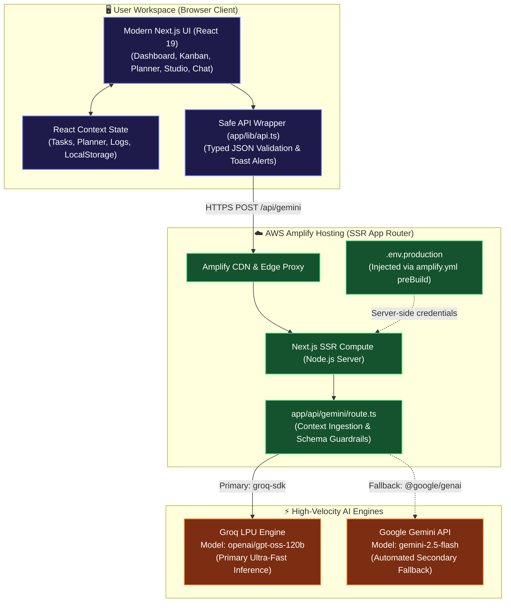
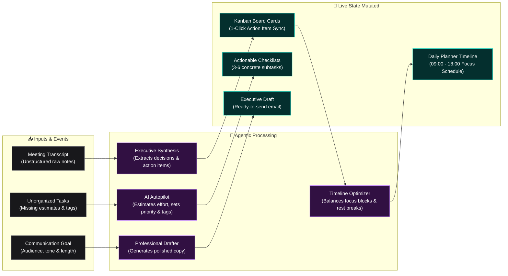

<div align="center">

# 🧠 ProductivityOS AI

### High-Velocity Enterprise Productivity Workspace Powered by Groq & GenAI

[](https://nextjs.org/)
[](https://www.typescriptlang.org/)
[](https://tailwindcss.com/)
[](https://groq.com/)
[](https://main.d1fa52fy3h96m8.amplifyapp.com/)
[](LICENSE)

<br />

### 🌐 Live Production URL

👉 **[https://main.d1fa52fy3h96m8.amplifyapp.com/](https://main.d1fa52fy3h96m8.amplifyapp.com/)**

<br />

[🚀 Launch Live App](https://main.d1fa52fy3h96m8.amplifyapp.com/) · [✨ Features](#-core-modules) · [⚡ Quick Start](#-quick-start) · [🏗️ Architecture](#️-architecture)

<br />

</div>

---

## 📖 Overview

**ProductivityOS AI** is an all-in-one generative AI productivity workspace engineered to eliminate context switching and streamline task execution.

Powered by **Groq's ultra-low latency inference engine** running `openai/gpt-oss-120b` (with automated Gemini fallback), ProductivityOS AI helps individuals and engineering teams organize backlogs, auto-estimate workloads, generate structured checklists, optimize daily timelines, synthesize meeting notes, and compose professional communications in sub-second responses.

---

## 🚀 Live Demo & Access

You can test the fully functional app directly in your browser without local setup:

* **Production URL:** [https://main.d1fa52fy3h96m8.amplifyapp.com/](https://main.d1fa52fy3h96m8.amplifyapp.com/)
* **Hosting:** AWS Amplify Hosting (Next.js SSR App Router)

---

## ✨ Core Modules

The platform is organized into five streamlined, intuitive workspace modules:

### 1. 📊 Productivity Insights Dashboard
- **Executive AI Coach**: Analyzes task velocity, completion trends, and focus metrics to deliver personalized strengths, bottlenecks, and actionable weekly recommendations.
- **Velocity Metrics**: Visual trackers for completion percentage, active workloads, and total focus hours.
- **Activity Log**: Real-time audit trail of user actions and AI agent executions.

### 2. 📋 AI Task Board & Kanban
- **Visual Kanban Board**: Drag, reorder, and update tasks across `Todo`, `In Progress`, `Review`, and `Done` swimlanes.
- **⚡ AI Autopilot**: 1-click batch analysis that estimates completion time in minutes, assigns priorities (`low`, `medium`, `high`, `urgent`), and generates contextual tags.
- **🔨 AI Subtask Checklist Generator**: Generates concrete, step-by-step subtask checklists directly inside any task card.

### 3. 🤖 AI Workspace Assistant
- **Context-Aware Chat**: Directly references your current tasks, timeline, and priorities to provide tailored guidance.
- **Instant Suggestions**: Quick starter prompts for standup summaries, workload reviews, and action items.
- **Action-Oriented Markdown**: Clean, formatted replies ready for immediate execution.

### 4. 📅 Smart Daily Planner
- **Interactive Timeline**: Plan schedule blocks from 09:00 to 18:00 with categorized tags (`work`, `meeting`, `break`, `personal`).
- **✨ AI Schedule Optimizer**: Automatically distributes high-priority tasks during peak morning focus, balances workloads, and schedules lunch and rest breaks.

### 5. 🪄 AI Productivity Studio
Unified workspace consolidating essential communication and document tools:
- **📝 Meeting Notes Summarizer**: Converts unstructured transcripts into executive summaries, key decisions, and action items with a **1-click sync to your Kanban board**.
- **📄 Document Analyzer**: Synthesizes lengthy documents into concise summaries, hierarchical outlines, or Q&A study flashcards.
- **✉️ Professional Email Drafter**: Composes executive emails tailored by audience, tone (`Professional`, `Friendly`, `Urgent`, `Persuasive`, `Casual`), and length.

---

## 🏗️ System Architecture



---

## 🔄 Intelligent Agentic Workflows



---

## 📁 Repository Structure

```
ProductivityOS AI
├── amplify.yml               # AWS Amplify SSR build specification & env injection
├── app/
│   ├── api/
│   │   ├── gemini/route.ts   # Unified AI backend (Groq + Gemini fallback)
│   │   └── groq/route.ts     # Direct Groq route alias
│   ├── components/
│   │   ├── DashboardView.tsx # Performance analytics & AI Coach
│   │   ├── TaskBoard.tsx     # Kanban board + Autopilot + Subtask breakdown
│   │   ├── AssistantView.tsx # Context-aware chat companion
│   │   ├── PlannerView.tsx   # Timeline scheduler & AI optimizer
│   │   ├── SummarizersView.tsx # AI Studio (Meeting Notes, Docs, Emails)
│   │   ├── Sidebar.tsx       # Streamlined 5-tab navigation
│   │   └── Header.tsx        # Workspace status & live AI engine badge
│   ├── context/
│   │   └── AppContext.tsx    # Central workspace state & local persistence
│   ├── lib/
│   │   ├── api.ts            # Robust, type-safe client API wrapper
│   │   └── groq.ts           # Shared Groq client instance
│   ├── globals.css           # Modern glassmorphism theme & styles
│   ├── layout.tsx            # App root layout with toast providers
│   └── page.tsx              # Clean view router
```

---

## ⚡ Quick Start

### Prerequisites
- **Node.js** 18.17+ or higher
- **npm**, **yarn**, or **pnpm**
- A **Groq API Key** (from [console.groq.com](https://console.groq.com)) or **Gemini API Key** (from [Google AI Studio](https://aistudio.google.com/))

### 1. Clone the Repository
```bash
git clone https://github.com/tanush326k/ProductivityOS-AI.git
cd ProductivityOS-AI
```

### 2. Install Dependencies
```bash
npm install
```

### 3. Configure Environment Variables
Create a `.env.local` file in the project root:
```env
# Groq API Key (Recommended for ultra-fast inference)
GROQ_API_KEY=your_groq_api_key_here

# Optional: Gemini API Key (Used as automated fallback)
GEMINI_API_KEY=your_gemini_api_key_here
```

### 4. Run Development Server
```bash
npm run dev
```

Open [http://localhost:3000](http://localhost:3000) in your browser to experience ProductivityOS AI.

---

## ☁️ AWS Amplify Deployment

This project includes a pre-configured [`amplify.yml`](amplify.yml) optimized for **Next.js App Router SSR**:

```yaml
version: 1
frontend:
  phases:
    preBuild:
      commands:
        - npm ci --cache .npm --prefer-offline
        - env | grep -E '^(GROQ_API_KEY|GROK_API_KEY|GEMINI_API_KEY)=' >> .env.production || true
    build:
      commands:
        - npm run build
  artifacts:
    baseDirectory: .next
    files:
      - '**/*'
  cache:
    paths:
      - .next/cache/**/*
      - .npm/**/*
```

To deploy on AWS Amplify:
1. Connect this repository to **AWS Amplify Hosting**.
2. Under **App settings ➔ Environment variables**, add `GROQ_API_KEY`.
3. Save and deploy — Amplify automatically runs the SSR build and serves the app globally.

---

## 🔒 Security & Best Practices

- **Zero Client Key Exposure**: All AI completions execute strictly on the server-side Next.js route handlers. No API keys are leaked to the client bundle.
- **Ignored Sensitive Files**: `.env*` files are strictly excluded from version control in `.gitignore`.
- **Typed Error Handling**: Protected against HTML/server errors with typed JSON validation and interactive toast notifications (`react-hot-toast`).

---

## 🛠️ Tech Stack

| Technology | Purpose |
|:---|:---|
| **AWS Amplify Hosting** | CI/CD, global hosting & Next.js SSR server compute |
| **Next.js 16 (Turbopack)** | Fullstack React framework with App Router |
| **TypeScript** | Strict compile-time type safety |
| **Groq SDK** | Ultra-low latency LLM inference (`openai/gpt-oss-120b`) |
| **Google GenAI** | Automated secondary fallback (`gemini-2.5-flash`) |
| **Tailwind CSS v4** | Dark-mode glassmorphic styling system |
| **Lucide Icons** | Consistent, modern iconography |
| **React Hot Toast** | Non-blocking user feedback notifications |

---

## 📄 License

This project is open-source and licensed under the [MIT License](LICENSE).
